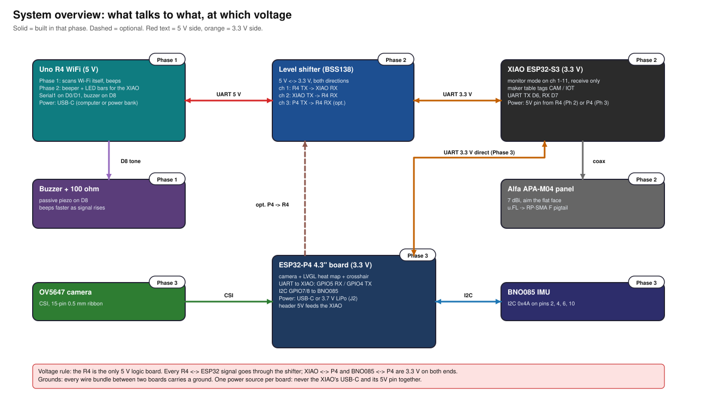

# 00. Overview, safety, tools and software

Manual for the Hidden Device Hunter. The current V2 build covers Phase 1 and Phase 2. Phase 3 is parked for later research and is not a V2 build step. Each active phase file stands alone:
parts, wiring diagram and schematic, pin-to-pin wire list, step-by-step assembly, checks before power, flashing, use, test, troubleshooting.
Status: Phase 1 is uploaded and serial bench-checked. The Seeed Studio XIAO ESP32-C5 Phase 2 firmware has received 2.4/5 GHz traffic; UART to R4 is not tested. The Rokland dual-band directional antenna is ordered but not delivered (see `../../HANDOFF.md`).

Legal: use only on your own home, network and devices. The finder passively listens; it does not break into or join anything.

## How the pieces fit


Phase 1 works alone. Phase 2 adds the XIAO as a sharper "RF eye" and turns the R4 into its beeper. Phase 3's P4 camera/display idea is parked for later research; do not build it from the preserved Phase 3 notes as part of V2. Every diagram is listed in [`05-reference.md`](05-reference.md).

## How to read the diagrams
- **Wiring diagrams** show connections; most are top views with wire IDs matching that phase's wire list. The current Phase 2 XIAO-C5
  diagram is a labeled connection layout, not a physical top-view pin placement. Use its pin labels and the pin-to-pin table, and follow
  the board's own silkscreen when wiring. Part placement is illustrative.
- **Schematics** (`phaseN-schematic.svg`) show the same circuit electrically: parts as boxes (U1 R4, U2 shifter, U3 XIAO, U4 P4, U5 BNO085),
  nets as lines, one ground symbol for the shared ground.
- **Colours** mean the same thing everywhere: red 5 V, orange 3.3 V, black ground; signal colours are in the legend in
  [`05-reference.md`](05-reference.md). Your real jumpers can be any colour.
- **Jumper ends:** the R4's headers and the breadboard are sockets, so a wire landing there needs a **male** end. The XIAO, the shifter,
  the BNO085 and the P4 header have pins, so a wire landing there needs a **female** end. Each wire list says M-M, M-F or F-F.
- **Build order** for the active phases: parts -> wire with everything unplugged -> continuity checks -> first power -> voltage checks -> firmware.

## Voltage rule (the one that destroys boards)
| Board | Logic level |
|---|---|
| Uno R4 WiFi (RA4M1) | **5 V** |
| Seeed XIAO ESP32-C5, ESP32-P4, BNO085 data lines, T3 | **3.3 V** |
Never connect an R4 pin straight to an ESP32 pin. R4 <-> ESP32 goes through the BSS138 level shifter (generic board or Adafruit 757). XIAO <-> P4 is 3.3 V both sides, direct.

## Safety rules
1. Wire only with everything unplugged. Do the phase's "checks before power" table with a meter before applying power.
2. For Phase 2 UART bench tests, power the R4 and XIAO C5 from separate USB-C cables; do not connect their 5 V rails.
3. Never transmit from the T3 LoRa radio without its antenna.
4. Do not hot-plug the u.FL antenna connector; click it on before power.
5. Check LiPo plug polarity against the board silkscreen before connecting (cheap cells are wired both ways).
6. Own network and devices only.

## Tools
| Tool / supply | Used for |
|---|---|
| Soldering iron (fine tip, ~330 C) and 0.6-0.8 mm solder | XIAO headers, shifter headers (if loose), BNO085 headers |
| Multimeter with continuity beep | every "checks before power" table; supply voltages; LiPo polarity |
| Half-size breadboard (400 points, + and - rails) | Phase 1 buzzer and resistor; Phase 2 5 V distribution |
| Jumper kit with all three types: M-M, M-F, F-F (40 each, 10-20 cm) | all wiring; count per type in `05-reference.md` |
| Flush cutters, heat-shrink, small Phillips screwdriver | trimming, insulating, mounting |
| USB-C data cables (not charge-only), x2 | R4 and XIAO (and P4) programming |
| Plate (plywood/acrylic ~20 x 15 cm), zip ties, hot glue or M2.5 standoffs | handheld mounting, strain relief for the coax |

## Software install (once, on HaL or HaLjr)
HaLjr already has ESP-IDF v5.5.5 (`~/esp/esp-idf-v5.5.5`) and `arduino-cli` (`tools/setup.sh` checks them).
1. Arduino IDE 2.x, or `arduino-cli`.
2. Install core **Arduino UNO R4 Boards** (`arduino:renesas_uno`): includes WiFiS3 and Arduino_LED_Matrix.
3. Add board URL `https://espressif.github.io/arduino-esp32/package_esp32_index.json`, install **esp32 by Espressif Systems** v3.x. Phase 2 board: `XIAO_ESP32C5`; enable USB CDC on boot for the USB serial console.
4. Linux serial permission: `sudo usermod -aG dialout $USER`, then log out and in.
5. P4 uses ESP-IDF (`. ~/esp/esp-idf-v5.5.5/export.sh`). Silicon rev quirks and BSP are in `~/.claude/skills/lvgl-ui/board-p4.md`: read it before building anything for the P4.
CLI equivalents:
```
arduino-cli core install arduino:renesas_uno
arduino-cli core install esp32:esp32   # after adding the board URL to the config
arduino-cli board list                 # shows which /dev/ttyACM* is which board
```

## Verification log (checked 2026-10-03)
| Fact | Status | Source |
|---|---|---|
| P4 40-pin header table (pins 1-40, GPIO numbers) | Verified | docs.waveshare.com/ESP32-P4-WIFI6-Touch-LCD-4.3 |
| P4 GPIO2/3/4/5 are free header GPIOs; I2C on GPIO7/8 shared with touch/audio/camera | Verified (header table, board-p4.md) | same, `board-p4.md` |
| P4 USBD_N/USBD_P pins 25/27 not usable as GPIO | Verified | Waveshare docs |
| XIAO ESP32-S3: D6 = GPIO43 (TX), D7 = GPIO44 (RX), 3V3 pin 700 mA, 5V pin dead on battery | Verified | wiki.seeedstudio.com xiao_esp32s3_getting_started |
| Seeed Studio XIAO ESP32-C5: D6=GPIO11/TX, D7=GPIO12/RX, BOOT=GPIO28 | Verified from installed board variant; UART/button use on this Phase 2 link remain to test | Arduino-ESP32 3.3.12 XIAO_ESP32C5 variant; merged PR #4 worklog |
| R4 WiFi: D0 = RX, D1 = TX, Serial1; 5 V logic; 8 mA per pin, 60 mA total; 5 V pin ~4.7 V on USB | Verified | Arduino docs via lastminuteengineers |
| R4 `tone()` works on D8 (any digital pin; timer-interrupt toggling) | Verified | ArduinoCore-renesas `Tone.cpp` |
| Adafruit 757 pin layout: LV, A1-A4, GND on one side; HV, B1-B4, GND on the other; 10K pull-ups | Verified | adafruit/4-Channel-Level-Shifter-PCB board file |
| BNO085 default address 0x4A; alternate 0x4B when DI is pulled high (NOT an ADR jumper); VIN 3-5 V; 10K I2C pull-ups on board | Verified (manual corrected) | learn.adafruit.com BNO085 pinouts |
| P4 battery connector J2: pin 1 = BAT, pin 2 = GND | Verified in schematic (physical pin 1 position: confirm on the board) | Waveshare schematic PDF |
| P4 header 5V = VCC_5V rail, fed from USB or battery boost (Q7); not gated by the power button | Verified in schematic; **live-measure once** | Waveshare schematic PDF |
| P4 CSI: 15-pin 0.5 mm, MIPI 2-lane; OV5647 supported | Verified | Waveshare product page |
