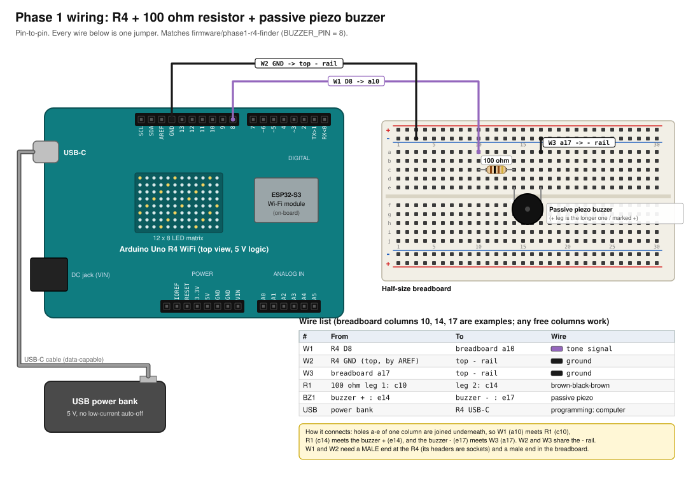
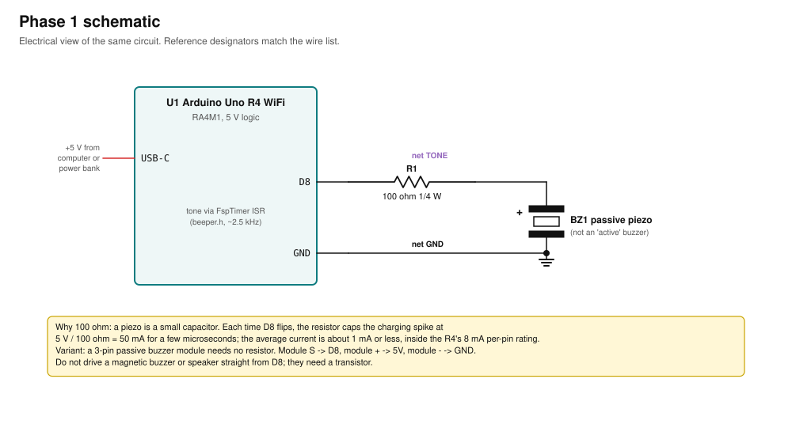

# 01. Phase 1: Wi-Fi finder with buzzer (Uno R4 WiFi)

Goal: the R4 scans Wi-Fi, you pick a target network, and the buzzer beeps faster (and the LED matrix shows more bars) as the signal
gets stronger. Handheld on a USB power bank.
Needs only a buzzer, a resistor, a breadboard and three jumpers. Everything is on the R4's own 5 V side, so there is no level shifter.
Firmware: [`firmware/phase1-r4-finder`](../../firmware/phase1-r4-finder) (compiles; not yet run on hardware).

Before starting, read [`00-overview-and-safety.md`](00-overview-and-safety.md) (voltage rule, how to read the diagrams, tools).

## 1.1 Parts
| Ref | Part | Spec | Qty | Price (USD) |
|---|---|---|---|---|
| U1 | Arduino Uno R4 WiFi | have | 1 | 0 |
| BZ1 | Passive piezo buzzer | 2-pin **passive** piezo (or a 3-pin passive module, see 1.4) | 1 | 1-4 |
| R1 | Resistor | 100 ohm, 1/4 W (colour bands brown-black-brown-gold) | 1 | <1 |
| - | Half-size breadboard | 400 tie-points, with + and - rails top and bottom | 1 | 3-5 |
| W1-W3 | Jumper wires | **male-to-male** (M-M), 10-20 cm | 3 | (kit) |
| - | USB power bank | 5 V, no low-current auto-off | 1 | 10-20 |
| - | USB-C cable | data-capable (not charge-only) | 1 | have |

"Passive" matters: a passive buzzer plays whatever tone the pin gives it; an active buzzer has its own oscillator and just buzzes at
one pitch when given 5 V. The firmware needs passive. To tell them apart: an active buzzer usually has a sealed bottom and a sticker;
put 5 V across it and it buzzes on its own. A passive one only clicks.

Why jumpers are male at both ends here: the R4's headers are **sockets** (female) and so is the breadboard. Female-ended jumpers do not
plug into either. Phase 2 needs other combinations; buy a mixed kit (M-M, M-F and F-F, 40 each) once and you are covered for every phase.

No breadboard? Twist (or solder) the resistor to the buzzer's + leg, cover it with heat-shrink, and push the free resistor leg
straight into the R4's D8 socket and the buzzer's - leg into a GND socket. Same circuit, fewer parts, less robust.

## 1.2 Diagrams
Wiring, pin to pin (every wire has an ID used in the steps and the troubleshooting table):



Schematic of the same circuit:



## 1.3 Pin-to-pin wire list
| ID | From | To | Jumper | Colour in diagram | Note |
|---|---|---|---|---|---|
| W1 | R4 **D8** (top header, 10-pin block, last socket before the gap) | breadboard **a10** | M-M | purple | tone signal (`BUZZER_PIN = 8`) |
| R1 | 100 ohm leg 1 in **c10** | leg 2 in **c14** | - | - | either way round |
| BZ1 | buzzer **+** leg in **e14** | buzzer **-** leg in **e17** | - | - | + is the longer leg, or marked + |
| W3 | breadboard **a17** | top **-** rail (any hole) | M-M | black | buzzer return |
| W2 | R4 **GND** (top header, between AREF and D13) | top **-** rail | M-M | black | ground |
| USB | R4 USB-C | computer (programming) or power bank (field) | USB-C cable | grey | power |

Columns 10, 14 and 17 are examples; any free columns work as long as the same column numbers line up. On a breadboard, the five holes
a-e of one column are joined underneath, so W1 meets R1 in column 10, R1 meets BZ1 + in column 14, and BZ1 - meets W3 in column 17.
The rail with the blue stripe (or "-" mark) is the one W2 and W3 go into; use the stripes on your breadboard, not the picture's order.

## 1.4 Variant: 3-pin passive buzzer module (no resistor, no breadboard)
| From (module pin) | To (R4) | Jumper |
|---|---|---|
| S (signal) | D8 | F-M (module has pins, R4 has sockets) |
| + (VCC) | 5V (power header) | F-M |
| - (GND) | GND | F-M |
The module carries its own transistor or resistor, so it goes straight onto the pins.

## 1.5 Step-by-step assembly
Do every step with **the R4 unplugged from USB**.

1. **Identify the R4's headers.** Hold the board with the USB-C port on your left and the LED matrix facing you. The long header along the
   top edge is the digital header: from left to right SCL, SDA, AREF, GND, 13, 12, 11, 10, 9, 8, (gap), 7, 6, 5, 4, 3, 2, TX>1, RX<0.
   The header along the bottom edge is power: (blank), IOREF, RESET, 3.3V, 5V, GND, GND, VIN. Compare with the diagram.
2. **Check the resistor.** Brown-black-brown(-gold) = 100 ohm. If unsure, measure it: the meter on the 200 ohm range should read 95-105.
3. **Seat R1.** Bend both legs down at 90 degrees, about 4 holes apart. Push one leg into **c10** and the other into **c14**. Both legs must be
   fully seated; the body sits flat on the breadboard.
4. **Seat BZ1.** Find the + leg (longer, or a + on the case). Push + into **e14** and - into **e17**. If the legs are spaced differently, gently
   bend them; what matters is + in column 14 and - in a column that has nothing else in it except W3.
5. **Run W1** (M-M): one end into R4 socket **D8**, the other into breadboard **a10**. Count the sockets twice: D8 is the 10th socket of the
   left block, right before the gap. D9 and D7 are the usual mistakes.
6. **Run W3** (M-M): **a17** to any hole of the top **-** rail.
7. **Run W2** (M-M): R4 **GND** on the top header (4th socket, between AREF and 13) to the same **-** rail.
8. **Visual check** against the wire list: D8 -> column 10 -> R1 -> column 14 -> BZ1 + ... BZ1 - -> column 17 -> rail -> GND.
   D8 must reach the buzzer only through the resistor.

## 1.6 Checks before power (multimeter, R4 unplugged)
Meter on continuity (beep) mode.
| Probe A | Probe B | Expect | If not |
|---|---|---|---|
| R4 D8 socket (touch the jumper's metal) | breadboard c10 (resistor leg) | beep | W1 not seated or in the wrong column |
| R4 D8 | buzzer + leg | **no** beep; on ohms: about 100 | resistor missing or bypassed |
| buzzer - leg | R4 GND (any GND socket) | beep | W3 or W2 not seated, or wrong rail |
| R4 D8 | R4 GND | **no** steady beep | a short; recheck columns |
Then turn the meter to resistance: D8 to GND should read open (OL) or very high. A piezo does not conduct DC.

## 1.7 Software: install and flash
Toolchain (once): see [`00-overview-and-safety.md`](00-overview-and-safety.md) section "Software install". Board: **Arduino UNO R4 WiFi**,
FQBN `arduino:renesas_uno:unor4wifi`.

1. Plug the R4 into the computer with the data-capable USB-C cable. The on-board power LED lights.
2. Find its port by serial number, not by `ttyACM` order (the SENTINEL P4 and TTGOs may be plugged in too):
   ```
   arduino-cli board list
   ```
   The R4 shows as `Arduino UNO R4 WiFi` with FQBN `arduino:renesas_uno:unor4wifi`. Note its port, e.g. `/dev/ttyACM0`.
3. Optional first: run **Test 1** (below) to prove the buzzer, then **Test 2** to see what the R4 can hear.
4. Compile and upload the finder:
   ```
   cd ~/Projects/hidden-device-hunter
   arduino-cli compile --fqbn arduino:renesas_uno:unor4wifi firmware/phase1-r4-finder
   arduino-cli upload  --fqbn arduino:renesas_uno:unor4wifi -p /dev/ttyACM0 firmware/phase1-r4-finder
   ```
   (Arduino IDE: open `firmware/phase1-r4-finder/phase1-r4-finder.ino`, pick the board and port, press Upload.)
5. Open the serial monitor at 115200 baud:
   ```
   arduino-cli monitor -p /dev/ttyACM0 -c baudrate=115200
   ```
   In the Arduino IDE Serial Monitor set **115200 baud** and line ending **Newline**.

### Test 1: buzzer only (3 beeps)
```cpp
void setup() {
  for (int i = 0; i < 3; i++) { tone(8, 2000, 150); delay(300); }
}
void loop() {}
```
Expect three short beeps after upload. If silent: swap the buzzer legs (piezos mostly don't care), re-check the resistor, then 1.6.
`tone()` works on D8: the R4 core drives it from a hardware timer interrupt that toggles any digital pin, so PWM capability is not
needed (verified in `ArduinoCore-renesas/cores/arduino/Tone.cpp`, 2026-10-03). The finder itself uses its own timer (`beeper.h`) for the same reason.

### Test 2: Wi-Fi scan with signal strength (serial monitor, 115200)
```cpp
#include <WiFiS3.h>
void setup() { Serial.begin(115200); while (!Serial) {} }
void loop() {
  int n = WiFi.scanNetworks();
  for (int i = 0; i < n; i++) {
    byte b[6]; WiFi.BSSID(i, b);
    char mac[18]; snprintf(mac, sizeof mac, "%02X:%02X:%02X:%02X:%02X:%02X", b[0], b[1], b[2], b[3], b[4], b[5]);
    Serial.print(WiFi.SSID(i)); Serial.print("  "); Serial.print(mac);
    Serial.print("  RSSI "); Serial.print(WiFi.RSSI(i)); Serial.print(" dBm  ch "); Serial.println(WiFi.channel(i));
  }
  Serial.println("---"); delay(2000);
}
```
Each scan takes a few seconds. The finder prints MACs in the same byte order as this test.

## 1.8 What you should see at power-up (finder firmware)
1. The LED matrix shows a **?** (no target yet).
2. A short chirp from the buzzer (proves BZ1 and W1-W3).
3. On the serial monitor:
   ```
   === Hidden Device Hunter - Phase 1 (Uno R4 WiFi) ===
   Wi-Fi module firmware: 0.x.x
   Commands: <number> = lock target   l = list   c = clear target   m = mute   h = help
   Scanning...
   ```
   then a numbered table of networks: name, MAC, channel, signal in dBm, security.
4. If it prints `ERROR: Wi-Fi module not responding`, unplug and replug. If it says the module firmware is older than the library
   expects, update it with the Arduino IDE (Tools > Firmware Updater).

## 1.9 Using it
| Type in the monitor | Does |
|---|---|
| `3` (a number) + Enter | locks onto network 3 from the last list; saved to EEPROM, survives unplugging |
| `l` | shows the list again |
| `c` | clears the target |
| `m` | mutes / unmutes the buzzer |
| `h` | help |

What the outputs mean once locked:
| Output | Meaning |
|---|---|
| beeps every 1.2 s, 1 bar | very weak (-90 dBm or below) |
| beeps speed up, bars rise (0-12 columns) | getting closer; strength = (RSSI + 90) / 55 |
| steady tone, all bars | -35 dBm or stronger: it is right there |
| **X** on the matrix + one quiet click every 2 s | target not heard for 3 scans (off, out of range, or not in the 10 strongest) |
| moving dot on the bottom row | no target set; waiting |
The R4 scan updates every few seconds, so walk slowly and pause. The firmware averages readings (60 % old, 40 % new) to calm the jumps.
Tune `RSSI_FAR` / `RSSI_NEAR` at the top of the sketch if the bars sit at full too early or never move.

Field use: lock the target at the computer, unplug, plug the R4 into the power bank. It starts up locked onto the saved target.

## 1.10 Field test
1. Phone hotspot on, 2.4 GHz band (on iPhone: "Maximize Compatibility"), in another room.
2. Lock onto it. Walk toward it; beeps should speed up near it.
3. Walk past and away; beeps slow down. Note the dBm at 1 m and at the far end of the house in `docs/worklog/`.

## 1.11 Troubleshooting (Phase 1)
| Symptom | Check first | Then |
|---|---|---|
| No startup chirp | W1 in D8 (not D7/D9), R1 seated, BZ1 + in column 14 | run Test 1; check the buzzer is passive; checks in 1.6 |
| Chirp but very quiet | passive piezo without a resonant case is quiet | try a different piezo or the 3-pin module |
| Board not in `arduino-cli board list` | data-capable cable, other USB port | `dialout` group (00), double-tap RESET for bootloader mode |
| Scan shows nothing | R4 Wi-Fi module firmware | Arduino IDE Firmware Updater |
| My network is missing | R4 lists only the 10 strongest, skips hidden names, 2.4 GHz only | move closer; Phase 2 has none of these limits |
| Power bank shuts off | low-current auto-off | bank with an always-on mode |
| Beep rate jumps around | walls and bodies reflect 2.4 GHz | hold the R4 away from your body, pause between steps |
