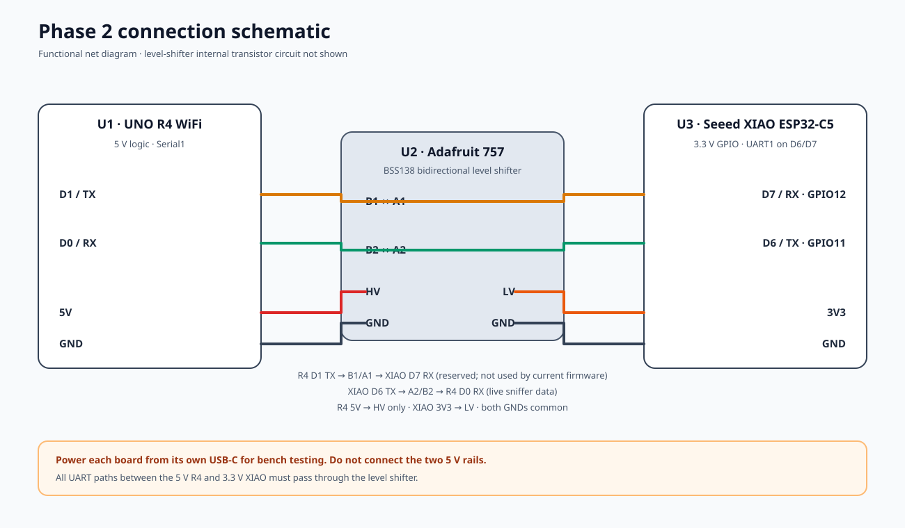

# 02. Phase 2: Seeed Studio XIAO ESP32-C5

Phase 2 uses the **Seeed Studio XIAO ESP32-C5** as a passive Wi-Fi monitor and the UNO R4 WiFi as the display and beeper. The C5 hops across 2.4 and 5 GHz channels, records transmitters it hears, and sends a locked target's signal readings to the R4 over UART.

The C5 firmware was flashed and tested on 2026-10-18. Its serial output listed a device on 5 GHz channel 36 and an access point on 2.4 GHz channel 2. The UART connection to the R4, BOOT-button selection, and saved-lock recovery have not yet been tested together.

## Wiring diagram


## Connection schematic



## Pin-to-pin connections

Use an Adafruit 757 or a compatible four-channel BSS138 bidirectional level shifter. Identify connections by their printed labels; clone board pin order can vary.

| From | Through | To | Purpose |
|---|---|---|---|
| R4 5V | — | Shifter HV | 5 V reference for the shifter high side |
| XIAO 3V3 | — | Shifter LV | 3.3 V reference for the shifter low side |
| R4 GND | Common ground | Shifter GND and XIAO GND | Shared signal reference |
| R4 D1 TX | HV B1 ↔ LV A1 | XIAO D7 RX (GPIO12) | Reserved R4-to-XIAO UART direction; current firmware does not use it |
| XIAO D6 TX (GPIO11) | LV A2 ↔ HV B2 | R4 D0 RX | Live XIAO-to-R4 readings |

The live data path is **XIAO D6 TX → A2/B2 → R4 D0 RX**. TX always connects to the other board's RX. Both serial ports use 115200 baud, 8-N-1.

### Power and logic safety

- Power the R4 and XIAO independently over their own USB-C cables for the initial UART bench test.
- Do **not** connect the R4 5 V rail to the XIAO 5V pin. In this wiring, R4 5V only supplies the shifter's HV reference; XIAO 3V3 supplies LV.
- Connect grounds together. Do not connect an R4 signal directly to an XIAO GPIO; UART signals go through the level shifter.
- The R4 uses the Qwiic Modulino Buzzer and its built-in LED matrix. There is no Phase 2 passive buzzer on D8.

## Antenna

A Rokland directional antenna rated for 2.4/5 GHz has been ordered but has not been delivered. When it arrives, confirm its cable and connector match the XIAO C5 RF connector before connecting it. Until then, use the XIAO's stock antenna for reception checks. The Alfa APA-M04 shown in the older guide is 2.4 GHz-only.

## Firmware and scan coverage

The flashed firmware's 2026-10-18 test reported 36 channels: US 2.4 GHz and 5 GHz, including DFS channels, with one sweep taking about eight seconds. It received traffic on both bands. Scanning is channel-hopping, not simultaneous; short-lived packets may be missed. This is passive observation, not precise distance measurement.

For the C5 USB serial console, build with USB CDC enabled:

```sh
arduino-cli compile --fqbn esp32:esp32:XIAO_ESP32C5:CDCOnBoot=cdc --warnings all firmware/phase2-xiao-sniffer
```

## Before field use

1. Run the firmware and R4 receiver using separate USB power, shared ground, and the level-shifted D6-to-D0 UART path.
2. Verify the R4 receives status and target lines before relying on its meter or buzzer.
3. Test the XIAO BOOT button and lock persistence independently; those behaviors are not yet documented as hardware-verified.
4. When the Rokland antenna arrives, verify connector fit with power off; then test reception on one 2.4 GHz and one 5 GHz channel.
