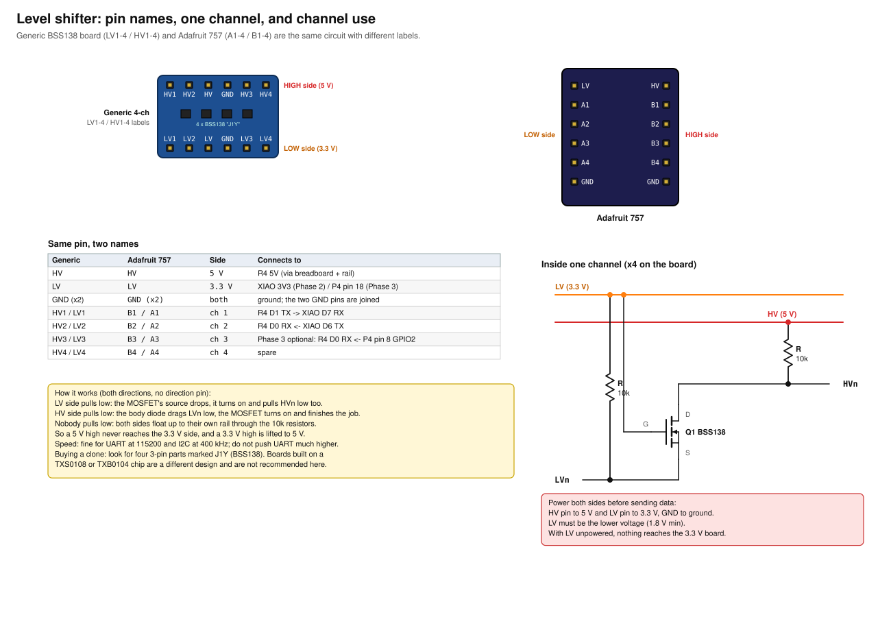
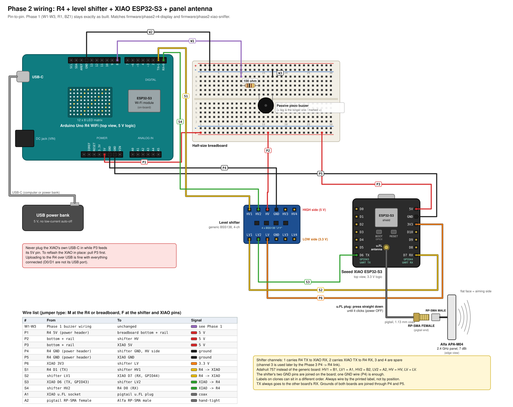
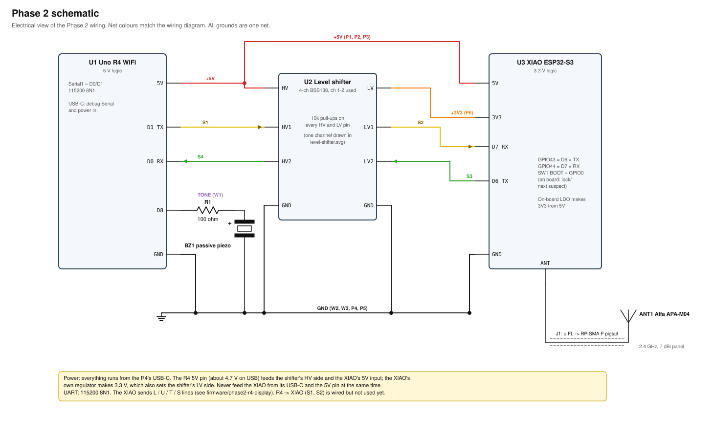

# 02. Phase 2: directional antenna + XIAO ESP32-S3 "RF eye"

Goal: a XIAO ESP32-S3 in monitor mode hears every 2.4 GHz radio around you, tags camera makers, locks onto one device and streams its
signal strength over UART to the R4, which beeps and shows bars. A 7 dBi panel antenna makes the reading directional: the tone peaks
when the flat face points at the device. This also finds devices that are not access points (cameras joined to your router, phones,
plugs) and networks with hidden names.

Requires Phase 1 built and working (the buzzer wiring W1-W3 stays exactly as it is). The R4 is 5 V logic and the XIAO is 3.3 V, so
the two talk through a level shifter.

Firmware: [`firmware/phase2-xiao-sniffer`](../../firmware/phase2-xiao-sniffer) (XIAO) and
[`firmware/phase2-r4-display`](../../firmware/phase2-r4-display) (R4). Both compile; not yet run on hardware.

## 2.1 Parts
| Ref | Part | Spec | Qty | Price (USD) |
|---|---|---|---|---|
| U3 | Seeed XIAO ESP32-S3 | the **plain** board (not "Sense"); has a u.FL antenna socket; comes with a small stock antenna | 1 | 7.49 |
| U2 | Logic level shifter, 4-channel | BSS138 type, bidirectional. Generic board labelled LV/HV, LV1-4/HV1-4, or Adafruit 757 (A1-4/B1-4) | 1 | 4-6 |
| J1 | u.FL to RP-SMA **female** bulkhead pigtail | 1.13 mm coax, 15-30 cm | 1 | 3.50-8 |
| ANT1 | 2.4 GHz panel antenna | Alfa APA-M04, 7 dBi, RP-SMA **male** | 1 | 8.97-14 |
| - | Pin headers | 2.54 mm male, 2 x 7 for the XIAO, 2 x 6 for the shifter (usually included with the shifter) | - | have |
| P1 | Jumper | M-M | 1 | (kit) |
| P2-P5, S1, S4 | Jumpers | M-F (male end into the R4 or breadboard, female end onto the shifter or XIAO pins) | 6 | (kit) |
| P6, S2, S3 | Jumpers | F-F (pin to pin, XIAO to shifter) | 3 | (kit) |
| - | Phase 1 build | R4 + breadboard + R1 + BZ1 + W1-W3 | - | done |

Connector check: the pigtail's RP-SMA **female** end mates with the Alfa's RP-SMA **male** plug. A plain SMA (non-RP) part will screw on
but the centre pins will not connect.
Jumper check: female-to-female jumpers alone are not enough. The R4 and the breadboard have sockets, so every wire that lands on them
needs a male end. A 3-type kit (M-M, M-F, F-F) covers this and Phase 3.

## 2.2 The level shifter, and which name is which


| Generic label | Adafruit 757 label | Side | In this build |
|---|---|---|---|
| HV | HV | high (5 V) | R4 5V (via breadboard + rail, P2) |
| LV | LV | low (3.3 V) | XIAO 3V3 (P6) |
| GND (both rows) | GND (both columns) | both | joined on the board; R4 GND goes to the HV-side one (P4) |
| HV1 / LV1 | B1 / A1 | ch 1 | R4 D1 TX -> XIAO D7 RX (S1, S2) |
| HV2 / LV2 | B2 / A2 | ch 2 | XIAO D6 TX -> R4 D0 RX (S3, S4) |
| HV3 / LV3 | B3 / A3 | ch 3 | spare now; Phase 3 optional P4 -> R4 link |
| HV4 / LV4 | B4 / A4 | ch 4 | spare |
Clones do not all print the pins in the same order. **Wire by the printed label, never by position.** The generic layout drawn here
(HV1 HV2 HV GND HV3 HV4 / LV1 LV2 LV GND LV3 LV4) is the SparkFun pattern most clones copy.
Buying: look for four tiny 3-pin parts marked "J1Y" (BSS138). Boards built on a TXS0108 or TXB0104 chip are a different design.

## 2.3 Diagrams
Wiring, pin to pin (Phase 1 wiring included and unchanged):



Schematic:



## 2.4 Pin-to-pin wire list
Phase 1 wires W1, W2, W3, R1 and BZ1 stay where they are.
| ID | From | To | Jumper | Colour | Signal |
|---|---|---|---|---|---|
| P1 | R4 **5V** (power header, 5th socket) | breadboard **bottom + rail** | M-M | red | 5 V (about 4.7 V on USB) |
| P2 | bottom + rail | shifter **HV** | M-F | red | 5 V reference for the high side |
| P3 | bottom + rail | XIAO **5V** | M-F | red | powers the XIAO |
| P4 | R4 **GND** (power header, 6th socket) | shifter **GND** (HV row) | M-F | black | ground |
| P5 | R4 **GND** (power header, 7th socket) | XIAO **GND** | M-F | black | ground |
| P6 | XIAO **3V3** | shifter **LV** | F-F | orange | 3.3 V reference for the low side |
| S1 | R4 **D1** (TX>1) | shifter **HV1** | M-F | yellow | R4 -> XIAO (wired for later; firmware does not send yet) |
| S2 | shifter **LV1** | XIAO **D7** (RX, GPIO44) | F-F | yellow | R4 -> XIAO |
| S3 | XIAO **D6** (TX, GPIO43) | shifter **LV2** | F-F | green | XIAO -> R4 |
| S4 | shifter **HV2** | R4 **D0** (RX<0) | M-F | green | XIAO -> R4 |
| A1 | XIAO **u.FL** socket | pigtail u.FL plug | - | grey | RF |
| A2 | pigtail RP-SMA female | Alfa APA-M04 RP-SMA male | - | grey | RF, hand-tight |
These match the firmware exactly: R4 `Serial1` is D0/D1 (`phase2-r4-display.ino`), XIAO `LINK_TX = D6`, `LINK_RX = D7`,
`Serial1.begin(115200, SERIAL_8N1, LINK_RX, LINK_TX)` (`phase2-xiao-sniffer.ino`). TX always goes to the other board's RX.

Rules this wiring keeps:
- No R4 pin touches an XIAO pin directly. Every signal passes HV <-> LV through the shifter.
- One power source for the XIAO: its 5V pin (P3). Its own USB-C stays unplugged while P3 is connected.
- Grounds are common (P4, P5 and Phase 1's W2 all go to R4 GND).

## 2.5 Step-by-step assembly

### Step 1: solder the headers (XIAO and shifter)
1. Cut two 7-pin strips of male header for the XIAO (and two 6-pin strips for the shifter if it came without headers).
2. Push the strips, long pins down, into a breadboard, spaced to match the board's two rows. The breadboard holds them straight.
3. Drop the XIAO onto the short pins, **component side up** (the side with the metal shield and the USB-C port). Do the same for the shifter
   with its labels up.
4. Solder one pin at each end first, check the board sits flat, then solder the rest. Each joint: heat pin and pad together for about 2 s,
   feed solder until it flows into a small shiny cone.
5. Let it cool, pull it out of the breadboard. **Meter check:** continuity between every pair of neighbouring pins must be **open** (no beep).
   Any beep is a solder bridge: reheat and drag it apart with the iron tip or use solder wick.

### Step 2: flash the XIAO on its own first
Nothing connected to the XIAO except its own USB-C cable. This proves the board before it is wired in.
1. Plug the XIAO into the computer. `arduino-cli board list` should show a new port (`/dev/ttyACM*`, Espressif USB JTAG/serial).
   If no port appears: unplug, hold **BOOT**, plug in, release BOOT. The board is now in download mode.
2. Compile and upload the sniffer:
   ```
   cd ~/Projects/hidden-device-hunter
   arduino-cli compile --fqbn esp32:esp32:XIAO_ESP32S3 firmware/phase2-xiao-sniffer
   arduino-cli upload  --fqbn esp32:esp32:XIAO_ESP32S3 -p /dev/ttyACM1 firmware/phase2-xiao-sniffer
   ```
   (Arduino IDE: board **XIAO_ESP32S3**.) If you uploaded in download mode, press **RESET** afterwards.
3. Monitor at 115200: `arduino-cli monitor -p /dev/ttyACM1 -c baudrate=115200`. Expect:
   ```
   === Hidden Device Hunter - Phase 2 sniffer (XIAO ESP32-S3) ===
   Maker list: 771 entries. Receive-only: this board never transmits.
   ```
   If the monitor stays empty, rebuild with USB CDC on boot enabled: add `:CDCOnBoot=cdc` to the FQBN
   (`esp32:esp32:XIAO_ESP32S3:CDCOnBoot=cdc`), or in the IDE Tools > USB CDC On Boot > Enabled.
4. Wait 20 s, type `l` + Enter: a table of devices should appear (with the small stock antenna fitted; any antenna works for this test).
5. Unplug the XIAO.

### Step 3: flash the R4 with the Phase 2 display sketch
The R4 stops being a scanner and becomes the XIAO's beeper and meter.
```
arduino-cli compile --fqbn arduino:renesas_uno:unor4wifi firmware/phase2-r4-display
arduino-cli upload  --fqbn arduino:renesas_uno:unor4wifi -p /dev/ttyACM0 firmware/phase2-r4-display
```
Expect a short chirp and `=== Hidden Device Hunter - Phase 2 display (Uno R4 WiFi) ===`, then `Waiting for the XIAO...`, with a dot moving
along the bottom row of the matrix. Unplug the R4.

### Step 4: wire power and ground (everything unplugged)
1. **P1** (M-M): R4 **5V** socket on the power header (count: blank, IOREF, RESET, 3.3V, **5V**) to the **bottom + rail** of the breadboard.
   Use the rail marked red / "+". The **top** rail pair already carries ground from Phase 1; keep 5 V on the **bottom** pair so the two can never meet.
2. **P2** (M-F): bottom + rail to shifter **HV**.
3. **P3** (M-F): bottom + rail to XIAO **5V** (top-right pin, USB-C facing up).
4. **P4** (M-F): R4 **GND** (the socket right after 5V) to shifter **GND** in the HV row.
5. **P5** (M-F): R4 **GND** (the next socket) to XIAO **GND** (second pin from the top on the right).
6. **P6** (F-F): XIAO **3V3** (third pin on the right) to shifter **LV**.

### Step 5: wire the signals
1. **S1** (M-F): R4 **TX>1** (D1) to shifter **HV1**.
2. **S2** (F-F): shifter **LV1** to XIAO **D7** (bottom-right pin).
3. **S3** (F-F): XIAO **D6** (bottom-left pin) to shifter **LV2**.
4. **S4** (M-F): shifter **HV2** to R4 **RX<0** (D0).
Read it back as two chains: R4 TX -> HV1 -> LV1 -> XIAO RX, and XIAO TX -> LV2 -> HV2 -> R4 RX.

### Step 6: antenna (power still off)
1. Unclip the stock antenna from the XIAO's u.FL socket: lift it straight up with a fingernail under the plug, not by the cable.
2. **A1:** line the pigtail's u.FL plug up over the socket, set one edge in, then press straight down on the centre until it clicks. Never
   rock it in and never plug or unplug it with power on. The socket is rated for only a few dozen matings, so do this once and leave it.
3. **A2:** screw the pigtail's RP-SMA female end onto the Alfa's RP-SMA male plug, finger-tight only.
4. Tape or zip-tie the coax to something rigid near the XIAO so a tug on the antenna pulls the tie, not the u.FL socket.

## 2.6 Checks before power (multimeter, everything unplugged)
Continuity (beep) mode:
| Probe A | Probe B | Expect | Wire proved |
|---|---|---|---|
| R4 5V socket | shifter HV pin | beep | P1, P2 |
| R4 5V socket | XIAO 5V pin | beep | P1, P3 |
| R4 GND socket | shifter GND (both pins) | beep | P4 (and the board's GND trace) |
| R4 GND socket | XIAO GND pin | beep | P5 |
| XIAO 3V3 pin | shifter LV pin | beep | P6 |
| R4 D1 socket | shifter HV1 | beep | S1 |
| shifter LV1 | XIAO D7 | beep | S2 |
| XIAO D6 | shifter LV2 | beep | S3 |
| shifter HV2 | R4 D0 socket | beep | S4 |
| R4 5V | R4 GND | **no** steady beep | no short on 5 V |
| XIAO 3V3 | XIAO GND | **no** steady beep | no short on 3.3 V |
| **R4 5V** | **XIAO 3V3, D6, D7** | **no** beep | 5 V cannot reach an ESP32 pin |
| R4 D0 / D1 | XIAO D6 / D7 | **no** beep | signals go through the shifter, not around it |
A short chirp when you first touch a supply pair is the capacitors charging; a steady beep is a short.

## 2.7 First power-up and voltage checks
1. Make sure the XIAO's USB-C is **unplugged**. Plug the R4 into the computer (USB).
2. Within a second the R4 chirps and the matrix shows the moving dot (nothing locked yet). The XIAO has no plain power LED, so check it
   with the meter in the next step.
3. Meter on DC volts, black probe on any GND:
   | Point | Expect | If not |
   |---|---|---|
   | R4 5V socket | 4.6-5.1 V | weak USB port; try the power bank |
   | shifter HV | same as R4 5V | P2 |
   | XIAO 5V pin | same as R4 5V | P3 |
   | XIAO 3V3 / shifter LV | 3.2-3.4 V | P6; XIAO regulator |
   | shifter HV2 (idle) | about 5 V | pull-up; S4 |
   | shifter LV1 (idle) | about 3.3 V | **if near 5 V, unplug at once:** HV and LV are swapped |
4. Open the R4 monitor (`arduino-cli monitor -p <R4 port> -c baudrate=115200`). Every line the XIAO sends appears here, for example
   `S,23,1,4,0,0` once a second. A few lines of ESP32 boot text at power-up are normal and ignored.

## 2.8 UART link test (only if 2.7 shows nothing from the XIAO)
Load these two tiny sketches instead of the real firmware to test the wires alone.
XIAO (flash it with P3 **pulled**, over its own USB, then unplug USB and put P3 back):
```cpp
void setup() { Serial1.begin(115200, SERIAL_8N1, D7, D6); }   // RX = D7, TX = D6
void loop() { Serial1.println("ping from xiao"); delay(500); }
```
R4:
```cpp
void setup() { Serial.begin(115200); Serial1.begin(115200); }
void loop() { while (Serial1.available()) Serial.write(Serial1.read()); }
```
The R4 monitor should show `ping from xiao` twice a second. Nothing: S3, S4, P6 (LV unpowered blocks the channel), common ground.
Garbage characters: baud mismatch or a loose ground.

## 2.9 Using it
Two ways to drive the XIAO:

**At the computer (full control).** Pull **P3**, then plug the XIAO's USB-C into the computer. The XIAO now powers itself from USB and P5 keeps
the grounds joined, so the R4 keeps beeping. Open the XIAO monitor at 115200:
| Command | Does |
|---|---|
| `l` | list devices heard in the last 60 s, strongest first: MAC, type (AP/client), maker, channel, avg dBm, packets, age, network name |
| `c` | list only suspects: CAM makers, IOT chips, hidden networks |
| `3` (a number) | lock onto device 3 from the last list (saved; the XIAO picks it up again after a power cycle) |
| `m 24:0A:C4:12:34:56` | lock onto a MAC typed in full |
| `u` | unlock, back to scanning all channels |
| `h` | help |
When done, unplug the XIAO's USB-C and put P3 back.

**In the field (no computer).** The XIAO's **BOOT** button: short press = lock the next suspect (CAM makers first, then IOT, then strongest);
hold 1 s = unlock.

What the R4 shows (from `phase2-r4-display.ino`):
| R4 output | Meaning |
|---|---|
| dot moving along the bottom row, silent | nothing locked |
| camera picture for 1.5 s + quick triple chirp | just locked onto a device whose maker is on the camera list |
| beeps every 1.2 s up to a steady tone, 0-12 bars | locked target; louder/faster = stronger (-90 dBm = 0 %, -30 dBm = 100 %) |
| **X** + one quiet click every 2 s | locked target silent for 3 s; the XIAO searches all channels after 4 s |
The R4 monitor also logs every line from the XIAO: `L,<MAC>,<cat>,<maker>` (locked; cat 1 = camera maker, 2 = IoT chip),
`U` (unlocked), `T,<now>,<avg>,<ch>` (target dBm, about 10 a second), `S,<total>,<cams>,<iot>,<hidden>,<locked>` (once a second).

## 2.10 Holding and aiming
- Mount everything on one rigid plate (plywood or acrylic, about 20 x 15 cm): antenna on the front edge, flat face forward, R4 and breadboard
  behind it, XIAO close to the antenna so the coax stays short and slack-free. Power bank underneath.
- Hold the unit at chest height with your body **behind** the antenna. Your body blocks 2.4 GHz.
- Sweep slowly (about 2 s for a 90 degree sweep), pause, sweep back. The peak is where the tone is fastest; turn around a full circle
  first to find the rough direction, then walk that way and repeat.
- Close to the device, the signal saturates everywhere. Raise `RSSI_NEAR` in `phase2-r4-display.ino`, or step back and sweep again.

## 2.11 Field test
Phone on your Wi-Fi in the next room. Lock onto its MAC (find it in the phone's Wi-Fi settings, "Wi-Fi address"; turn off private/random
address for your network for the test, or match the random one in the `l` list). Sweep; the tone should peak when aimed through the wall
at the phone. Log the result in `docs/worklog/`.

## 2.12 Troubleshooting (Phase 2)
| Symptom | Check first | Then |
|---|---|---|
| R4 shows nothing from the XIAO | S3 and S4 (XIAO D6 -> LV2 -> HV2 -> R4 D0), P6 (LV powered?) | link test 2.8 |
| Garbled lines | same baud (115200)? ground P5 seated? | shorten jumpers; keep the shifter close to the XIAO |
| XIAO 5V pin reads 0 V | P1, P3, rail used (bottom +) | measure 2.7 |
| XIAO resets or R4 browns out | weak USB port | use the power bank; the XIAO draws more while scanning |
| XIAO hears almost nothing | u.FL fully clicked? coax kinked? | refit the stock antenna to prove the XIAO |
| XIAO not in the port list | BOOT-hold procedure, data cable | `dialout` group |
| Lists show "(random MAC)" | phones and many new devices randomise their MAC | expected; no maker info for these |
| 5 GHz devices never show | 2.4 GHz only | expected limit |
| Tone peaks in two directions | reflections off walls, metal, mirrors | trust the stronger peak, then move and re-sweep from a new spot |
