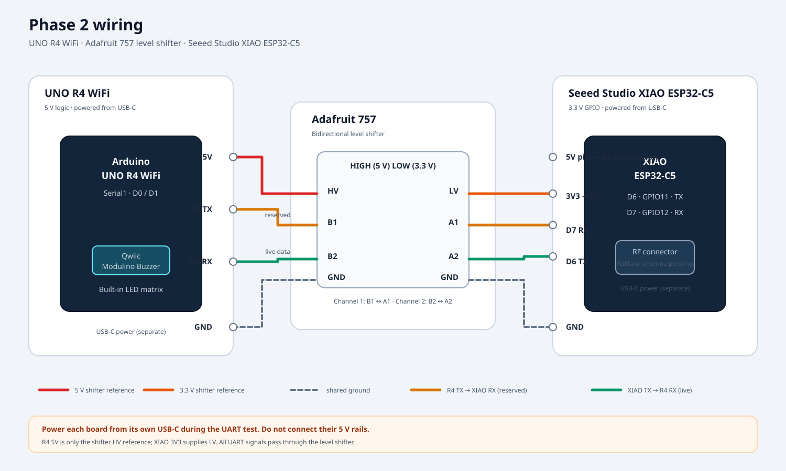

# 02. Phase 2: Seeed Studio XIAO ESP32-C5 + directional antenna

The Phase 2 sniffer is a **Seeed Studio XIAO ESP32-C5**. It passively hops between configured 2.4 GHz and 5 GHz Wi-Fi channels, records transmitter MAC addresses and RSSI, and sends a locked target's readings to the UNO R4 WiFi over UART. The R4 displays signal bars and drives the Modulino Buzzer.

The C5 replaced the originally planned XIAO ESP32-S3; it is not an additional second board. The drawing below uses the verified XIAO C5 pin labels, not the generic ESP32-C5 carrier pinout.

## Verification status

- The Seeed XIAO ESP32-C5 was identified, flashed, and tested on 2026-10-18. The recorded test received a 5 GHz device on channel 36 and an access point on 2.4 GHz channel 2. USB serial required `CDCOnBoot=cdc`.
- The current local firmware changes compile for the generic C5 and now select the XIAO-specific D6/D7 UART pins and GPIO28 BOOT button when building for the Seeed XIAO ESP32-C5.
- The sniffer-to-R4 UART cable, R4 D1-to-C5 return path, lock persistence, and BOOT-button selection have not been bench-tested together.
- The current local channel profile uses US 2.4 GHz channels 1-11 and non-DFS 5 GHz channels 36-48 and 149-165. This is not the same channel list as the earlier flashed test firmware, which also included DFS channels.
- A Rokland directional antenna rated for 2.4/5 GHz has been ordered but has not been delivered yet. Its exact connector and cable fit are still to be checked when it arrives.

## Wiring diagram



## Pin-to-pin connections

Use an Adafruit 757 four-channel logic shifter (or the same BSS138 bidirectional design). Wire by the printed pin labels, not by physical position; clone layouts can differ.

| From | Through | To | Purpose |
|---|---|---|---|
| R4 5V | — | Shifter HV | 5 V reference for the shifter high side |
| XIAO 3V3 | — | Shifter LV | 3.3 V reference |
| R4 GND | common ground | Shifter GND and XIAO GND | Shared reference |
| Separate USB-C supply | — | R4 and XIAO USB-C ports | Power each board independently during UART bench tests |
| R4 D1 TX | HV B1 → LV A1 | XIAO D7 RX (GPIO12) | Reserved R4-to-sniffer UART direction |
| XIAO D6 TX (GPIO11) | LV A2 → HV B2 | R4 D0 RX | Sniffer-to-R4 readings |

The R4-to-sniffer line is wired for future use but is not currently consumed by the firmware. The live data path is XIAO D6 TX through channel 2 to R4 D0 RX.

**Power safely:** the UART diagram does not connect the R4 5V rail to the XIAO 5V pin. Power the two boards separately over USB for initial link testing; share ground through the shifter. Never connect R4 5 V to a XIAO GPIO.

The R4's buzzer is the **Modulino Buzzer connected to Qwiic**; the R4 LED matrix is built in. Do not add the old passive buzzer/resistor wiring on D8.

## Antenna

The ordered Rokland directional antenna is rated for both 2.4 GHz and 5 GHz, but has not arrived. When it does, confirm that its cable/connector matches the XIAO C5 RF connector before connecting it. Until then, use the XIAO's stock antenna for reception checks. The Alfa APA-M04 shown in the older guide is 2.4 GHz-only and is not suitable for aiming at 5 GHz devices.

## Scan coverage and limits

The current local profile requests the US regulatory domain and 2.4 + 5 GHz band mode. It scans:

- 2.4 GHz: channels 1-11
- 5 GHz: channels 36, 40, 44, 48, 149, 153, 157, 161, 165

DFS, 6 GHz, Bluetooth, and other regulatory domains are not covered. One radio tunes one channel at a time; it does not receive both bands simultaneously. At 220 ms per channel, a full 20-channel sweep takes about 4.4 seconds, so short-lived packets can be missed. Readings are passive observations, not precise distance measurements.

## Build

Compile for the actual Seeed XIAO ESP32-C5 board, enabling USB CDC so the serial console remains on USB:

```sh
arduino-cli compile --fqbn esp32:esp32:XIAO_ESP32C5:CDCOnBoot=cdc --warnings all firmware/phase2-c5-sniffer
```

The older XIAO ESP32-S3 profile is not used for this project build.

```sh
arduino-cli compile --fqbn esp32:esp32:XIAO_ESP32S3 --warnings all firmware/phase2-xiao-sniffer
```

## Still to test

1. Connect XIAO D6 TX through LV A2/B2 to R4 D0 RX, and verify the R4 receives target readings.
2. Test the optional R4 D1 TX through HV B1/LV A1 to XIAO D7 RX only if later firmware needs it.
3. Verify the XIAO BOOT-button lock/unlock behavior and saved-lock recovery.
4. Confirm the selected antenna and cable are suitable for both bands before directional field tests.
