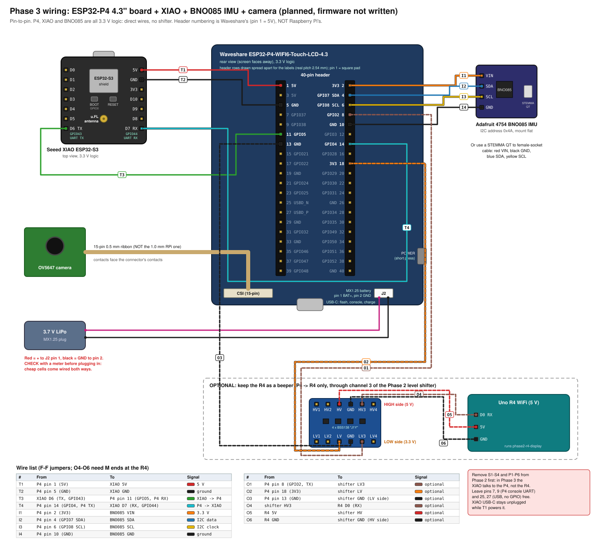
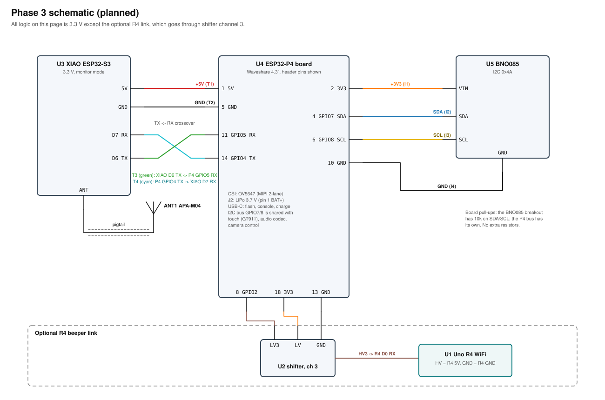

# 03. Phase 3: RF camera on the ESP32-P4 touchscreen

Goal: the built-in 4.3 in screen shows a live camera image with a heat-map overlay (red = strong signal) and a crosshair readout. An IMU tells the P4 where the antenna is pointing;
the XIAO sends signal strength; the P4 paints the readings onto the image at the matching position. Requires Phases 1-2 working.
All signals on the P4 side are 3.3 V, so the XIAO connects directly (no shifter). The R4 can stay as the proximity beeper.

## Parts
| Part | Spec | Price |
|---|---|---|
| Waveshare ESP32-P4-WIFI6-Touch-LCD-4.3 | have; 480x800 touch screen, GT911 touch, MIPI-CSI camera port, 40-pin header, MX1.25 battery | 0 |
| OV5647 camera | 15-pin **0.5 mm** ribbon (Waveshare's OV5647); standard RPi Camera (B) ribbons are 1.0 mm and do NOT fit | ~16-20 |
| BNO085 IMU | Adafruit 4754 STEMMA QT | 24.95-29.50 |
| STEMMA QT to female-header cable | Adafruit 4-pin | 0.95 |
| 3.7 V LiPo | MX1.25 plug; check polarity | 8-15 |
| Handle / mount | plywood, acrylic or 3D print; M2.5 standoffs | 5-15 |
| XIAO + panel antenna + pigtail | from Phase 2 | have |
| Jumpers | F-F x 8 (T1-T4, I1-I4), plus O1-O3 F-F and O4-O6 M-F if the R4 stays as a beeper | kit |

## P4 40-pin header (verified 2026-10-03, Waveshare docs)
Numbering is Waveshare's, not Raspberry Pi's: pin 1 is 5V. Odd pins are the left column, even pins the right column when the header is viewed with pin 1 at top-left.
| Pin | Signal | Pin | Signal |
|---|---|---|---|
| 1 | 5V | 2 | 3V3 |
| 3 | 5V | 4 | SDA (GPIO7) |
| 5 | GND | 6 | SCL (GPIO8) |
| 7 | GPIO37 | 8 | GPIO2 |
| 9 | GPIO38 | 10 | GND |
| 11 | GPIO5 | 12 | GPIO3 |
| 13 | GND | 14 | GPIO4 |
| 15 | GPIO21 | 16 | GPIO28 |
| 17 | GPIO22 | 18 | 3V3 |
| 19 | GND | 20 | GPIO29 |
| 21 | USB1P1_N (GPIO24) | 22 | GPIO30 |
| 23 | USB1P1_P (GPIO25) | 24 | GPIO31 |
| 25 | USBD_N (no GPIO) | 26 | GND |
| 27 | USBD_P (no GPIO) | 28 | GPIO34 |
| 29 | GND | 30 | GPIO35 |
| 31 | GPIO32 | 32 | GPIO49 |
| 33 | GND | 34 | GPIO50 |
| 35 | GPIO46 | 36 | GPIO51 |
| 37 | GPIO47 | 38 | GPIO52 |
| 39 | GPIO48 | 40 | GND |
**Header 5V pins (1, 3):** per the schematic these are the VCC_5V rail, fed from USB or, on battery, from an on-board boost converter through a P-FET (Q7), with a 5.0 V TVS diode. The power-button gate (Q6) switches a different rail (Core_5V), so header 5V should be live on battery even when the screen is "off"; confirm once with a multimeter. The boost chip's current rating is not stated in the schematic; the XIAO draws well under 0.4 A.
Leave GPIO37/38 (pins 7, 9) free: likely the USB-UART console. I2C GPIO7/8 is shared with touch, audio codec and camera; the BNO085 at 0x4A does not clash. On-board GPIOs in use (from `board-p4.md`): backlight 26, LCD reset 27, audio 9-13 and 53, SD 43/44. None of those are on the header pins used here.

## Diagrams
Wiring, pin to pin:

Schematic:

## Pin-to-pin wiring
Before you start: remove Phase 2's P1-P6 and S1-S4. In Phase 3 the XIAO talks to the P4, not the R4.
| ID | From | To (header pin, signal) | Jumper | Note |
|---|---|---|---|---|
| C1 | OV5647 ribbon | CSI connector | ribbon | 15-pin 0.5 mm; lift the connector latch, contacts toward the connector's contacts, close the latch |
| B1 | 3.7 V LiPo | MX1.25 battery header J2 | plug | schematic: J2 pin 1 = BAT (+), pin 2 = GND. Check your cell's red/black against that with a multimeter before plugging in; the board charges over USB-C |
| T1 | XIAO 5V | pin 1, 5V | F-F | powers the XIAO |
| T2 | XIAO GND | pin 5, GND | F-F | |
| T3 | XIAO D6 (TX, GPIO43) | pin 11, GPIO5 (P4 RX) | F-F | direct, both 3.3 V |
| T4 | XIAO D7 (RX, GPIO44) | pin 14, GPIO4 (P4 TX) | F-F | direct |
| I1 | BNO085 VIN | pin 2, 3V3 | F-F | |
| I2 | BNO085 SDA | pin 4, GPIO7 | F-F | |
| I3 | BNO085 SCL | pin 6, GPIO8 | F-F | |
| I4 | BNO085 GND | pin 10, GND | F-F | |
| A1, A2 | XIAO u.FL | pigtail -> panel antenna | - | as Phase 2 |
Ground pins were swapped on 2026-10-05 (XIAO GND on pin 5, BNO085 GND on pin 10; earlier notes had them the other way round). Both are
plain GND pins, so it is electrically the same; this way the BNO085 uses only right-column pins (2, 4, 6, 10) and the XIAO's power and RX
leave on the left column (1, 5, 11). Nothing in firmware depends on which GND pin is used.
BNO085 STEMMA QT cable colours: red = power (VIN), black = GND, blue = SDA, yellow = SCL. On the breakout, find each pin by its printed
label; the diagram draws them in header order, not board order.

Optional R4 beeper link (P4 -> R4 only, through channel 3 of the Phase 2 shifter):
| ID | From | To | Jumper |
|---|---|---|---|
| O1 | P4 pin 8 (GPIO2, P4 TX) | shifter LV3 | F-F |
| O2 | P4 pin 18 (3V3) | shifter LV | F-F |
| O3 | P4 pin 13 (GND) | shifter GND (LV side) | F-F |
| O4 | shifter HV3 | R4 D0 (RX) | M-F |
| O5 | R4 5V | shifter HV | M-F |
| O6 | R4 GND | shifter GND (HV side) | M-F |

## Checks before power (multimeter, battery and USB out)
| Probe A | Probe B | Expect |
|---|---|---|
| P4 pin 1 | XIAO 5V | beep (T1) |
| P4 pin 5 | XIAO GND | beep (T2) |
| XIAO D6 | P4 pin 11 | beep (T3) |
| XIAO D7 | P4 pin 14 | beep (T4) |
| BNO085 VIN / SDA / SCL / GND | P4 pin 2 / 4 / 6 / 10 | beep each (I1-I4) |
| P4 pin 1 (5V) | BNO085 VIN, XIAO D6, XIAO D7 | **no** beep |
| P4 pin 1 | P4 pin 5 | **no** steady beep |

## Assembly
1. Flash Waveshare's camera and display demos first, with only the camera attached, to prove the screen and camera work.
2. Build the handheld plate: antenna face forward, camera lens centred on the antenna face, screen toward you. Antenna and camera must point the same way.
3. Mount the BNO085 flat and rigid, at least 5 cm from the speaker, magnets and LiPo. Magnetic parts spoil the heading.
4. Wire everything with battery and USB out. Plug in the LiPo, short-press POWER.
5. Run an I2C scan: it should find 0x4A (plus the board's own devices: touch, audio codec). Check the XIAO UART lines on the P4 serial output.
6. Calibrate: hotspot 3 m away in open air; sweep, note where the signal peak sits against the on-screen position, and enter that offset in firmware. Do a figure-8 with the unit for 20 s for IMU magnetometer calibration.

## Software
ESP-IDF v5.5.5 on HaLjr (`. ~/esp/esp-idf-v5.5.5/export.sh`). Use the chip settings, BSP and LVGL notes in `~/.claude/skills/lvgl-ui/board-p4.md` and the `lvgl-ui` skill.
Critical: set `CONFIG_ESP32P4_REV_MIN_100=y` and `CONFIG_ESP32P4_SELECTS_REV_LESS_V3=y` (the board is rev v1.3), or the build will not boot.
Phase 3 firmware is not written yet. Parts: camera preview via LVGL, BNO085 heading and tilt over I2C, XIAO UART reader, heat-map layer, crosshair readout, optional R4 link.

## Field test
Hotspot hidden behind a wall: it appears as a hot spot on the image and stays put on the picture while you sweep.

## Troubleshooting (Phase 3)
| Symptom | Check first | Then |
|---|---|---|
| Screen black | board powered (short-press POWER) | Waveshare LCD demo; charge LiPo or use USB-C |
| No camera image | ribbon orientation, lens cap | Waveshare camera demo alone |
| BNO085 missing on I2C | VIN on 3V3, SDA/SCL not swapped | STEMMA cable; address 0x4A (0x4B only if the DI pin is pulled high) |
| Heading drifts | magnets, speaker, power bank near the IMU | move away; redo the figure-8 |
| No data from XIAO | TX/RX crossed? common ground (T2)? | check pin 11 / pin 14, baud 115200, XIAO powered |
| Board will not boot after build | silicon rev settings | rev config lines above |
| Flash port missing | CH343 driver (Windows only), data cable | `esptool chip_id` per `board-p4.md` |
