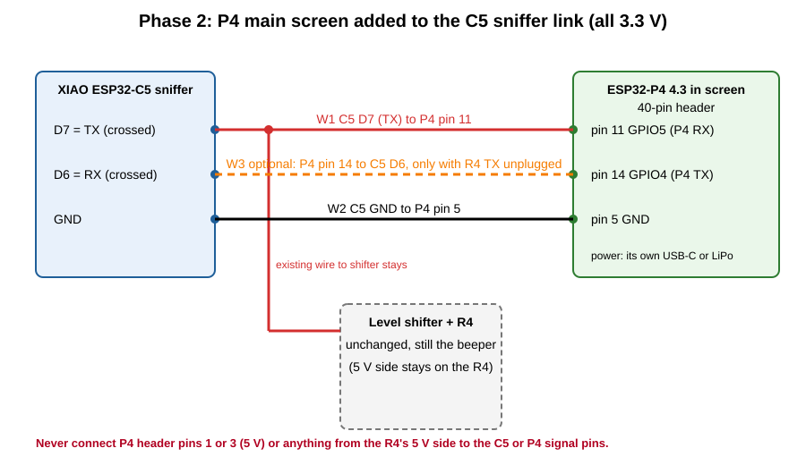

# Phase 2 P4 display (draft)

The Waveshare ESP32-P4-WIFI6-Touch-LCD-4.3 as the finder's main screen. It shows the same lines the C5 sniffer sends the R4:
sniffer connected, scan mode, device counts, the locked device with big dBm number, bar and closest approach, and the device list.
The R4 stays connected as the beeper and the phone page keeps working; the P4 only listens on the same wire.

Status: draft, not built or run yet. The Waveshare board package name in `main/idf_component.yml` could not be checked against the
component registry when this was written; the first build will say if it is wrong.

There is no P4 code in this repo yet, so this is fresh firmware. Flashing replaces everything on the board, so use this project's
own P4, not the SENTINEL one.

## Wiring, pin to pin


Everything here is 3.3 V: no level shifter between the C5 and the P4. Leave the C5-to-shifter-to-R4 wires as they are.

| ID | From | To (P4 header pin, signal) | Note |
|---|---|---|---|
| W1 | C5 D7 (its TX, because `LINK_CROSSED` is true) | pin 11, GPIO5 (P4 RX) | second wire on the same C5 pin as the shifter wire |
| W2 | C5 GND | pin 5, GND | common ground, required |
| W3 | optional: P4 pin 14, GPIO4 (P4 TX) | C5 D6 (its RX) | only after unplugging the R4's TX wire from the shifter; makes the P4 mode buttons work |

Power the P4 from its own USB-C or LiPo. Do not use header pins 1 and 3 (5 V) for anything here.

Checks before power (meter on beep, everything unplugged): C5 D7 to P4 pin 11 beeps; C5 GND to P4 pin 5 beeps; P4 pin 1 to P4 pin 11 does not beep.

## Build and flash (HaLjr, P4 alone on USB)
```
cd ~/Projects/hidden-device-hunter/firmware/phase2-p4-display
. ~/esp/esp-idf-v5.5.5/export.sh
idf.py set-target esp32p4
idf.py build flash
```
